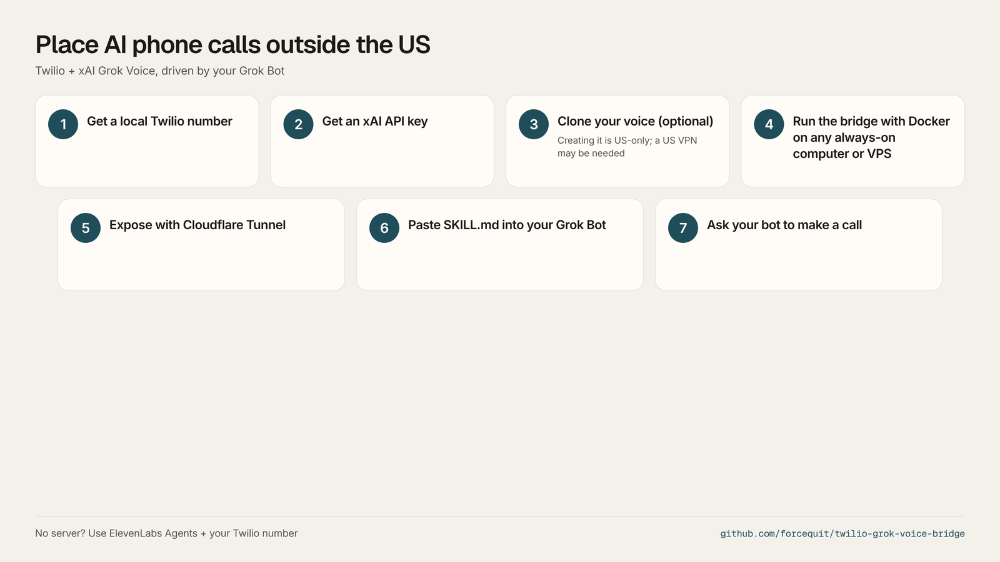

# Shareable Grok Voice phone-call setup (outside the US)



Grok Bot's built-in calling only works with **US numbers**. This folder is a templated, sanitized copy of the self-hosted bridge that lets a Grok Bot place real outbound calls anywhere Twilio will dial, using **Twilio Programmable Voice** and **xAI Grok Voice** (realtime).

You do **not** need Omarchy Linux, and you do not need this package to talk to anyone else's machine. You run your own bridge, with your own Twilio number and xAI key, then give your bot a short skill so it can place, steer, and hang up calls.

Copy the folder, fill your own secrets locally, and keep `.env` off git and out of chat.

## What's in this folder

| Path | What it is |
|------|------------|
| `twilio-grok-voice-bridge/` | Template server: Node source, `.env.example`, systemd units, Dockerfile, Compose file, and a Cloudflare Tunnel script |
| `skill/SKILL.md` | Generic Grok Bot skill you can paste into your own bot |
| `steps.png` | One-page steps graphic |
| `README.md` | This guide |

The server is derived from the public MIT project [jeffhuber/twilio-grok-voice-bridge](https://github.com/jeffhuber/twilio-grok-voice-bridge). This copy is generic: no personal phone numbers, API keys, voice ids, or machine ids.

## How it works

```
Your Grok Bot (curl on your machine, or HTTPS)
  -> POST /call on the bridge
    -> Twilio dials the callee from your Twilio number
      -> Twilio Media Streams (WSS, μ-law 8 kHz)
        <-> the bridge
          <-> xAI Grok Voice realtime
```

The bot sends a goal and optional context. The voice agent speaks on the PSTN call. Mid-call you can read `GET /transcript`, coach with `POST /steer`, switch voice with `POST /voice`, and hang up with `POST /hangup`. By default the model may only *request* hangup (`[[HANGUP_REQUESTED]]`); the bot (or you) must confirm.

## What you need

1. A **Twilio** account and a **voice-capable From number** in the country you will call from.
2. An **xAI** API key with Grok Voice / realtime access. See the [xAI Voice overview](https://docs.x.ai/developers/model-capabilities/audio/voice). Built-in voices include names such as `ara` and `eve`. Cloning your own voice is optional (see below).
3. An **always-on host** the bridge can run on, plus a **public HTTPS/WSS hostname** Twilio can reach. A laptop that sleeps will drop calls.

### Clone your voice (optional)

Built-in voices work without this step. To have the agent sound like you, use xAI [Custom Voices](https://docs.x.ai/developers/model-capabilities/audio/custom-voices): clone a short reference clip, then use the resulting `voice_id` anywhere a built-in voice works (including this bridge).

xAI's docs say Custom Voices is **currently only available in the United States, except Illinois**. If you are outside the US, you will likely need a US IP while *creating* the voice. Connecting a VPN to a US server (for example NordVPN) and then signing in to the [xAI console](https://console.x.ai) is one way that has worked. After the voice exists, you can turn the VPN off; the `voice_id` works from elsewhere (including a bridge running in Ireland).

1. Connect a VPN to a US server (skip this if you are already in the US; Illinois is excluded).
2. Sign in to the [xAI console](https://console.x.ai).
3. Create a Custom Voice by uploading or recording a clean sample of *your own* voice. The docs allow a clip of up to 120 seconds and recommend a quiet room, one speaker, and about 90–120 seconds for best results.
4. On the voice card, open the three-dot menu and choose **Copy Voice ID**.
5. Set `XAI_VOICE` in `.env` to that id, or pass `voice` on each `POST /call`. Do not commit the id if you want to keep the clone private, and do not paste it into the shared skill file — keep it in env or in your private bot config.

Creating voices through `POST /v1/custom-voices` is Enterprise-only. Everyone else should use the console. See the [Custom Voices guide](https://docs.x.ai/developers/model-capabilities/audio/custom-voices).

### Buy a local Twilio number (Ireland, UK, EU, and elsewhere)

Many non-US numbers are not sold until a **Regulatory Bundle** (and often a local address) is approved in the Twilio Console.

- Start with the [Twilio regulatory guidelines](https://www.twilio.com/en-us/guidelines) for your country.
- **Ireland:** local numbers typically need a name, contact email, and an address **with an Eircode in the locality or region of the number prefix**. A PO Box is not accepted where a local address is required. Mobile and national numbers need an address in Ireland. See [Ireland guidelines](https://www.twilio.com/en-us/guidelines/ie/regulatory).
- **United Kingdom:** UK long codes need an approved Regulatory Bundle before purchase. Local and national numbers need a valid UK address; mobile and toll-free may use an address anywhere in the world. See [UK guidelines](https://www.twilio.com/en-us/guidelines/gb/regulatory) and the [UK KYC article](https://help.twilio.com/articles/21038555454875).
- Other EU countries have their own identity and address rules. Trust the Twilio console and the official guidelines page; they change.

Create the bundle under Phone Numbers → Regulatory Compliance, wait for approval, buy a voice-capable number, and store it as E.164 in `TWILIO_FROM_NUMBER` (for example `+353…` or `+44…`).

Review recording-consent and AI-disclosure rules for your jurisdiction before you enable `ENABLE_RECORDING` or turn off disclosure.

## Setup

Full environment notes and the HTTP API are in `twilio-grok-voice-bridge/README.md`. The short path:

1. Copy `twilio-grok-voice-bridge/` to the always-on host.
2. `cp .env.example .env` and fill at least:
   - `TWILIO_ACCOUNT_SID`
   - `TWILIO_AUTH_TOKEN`
   - `TWILIO_FROM_NUMBER`
   - `XAI_API_KEY`
   - `XAI_VOICE` (default in the example is `ara`; use your Custom Voice id if you cloned one)
   - `BRIDGE_API_KEY` (generate with `openssl rand -hex 32`)
   - `PUBLIC_HOST` (hostname only, no `https://`) once the tunnel is up
   - `OWNER_NAME` and `OWNER_ORG`, or a full `CALLER_OPENER`, so the agent introduces itself as *your* AI assistant
3. Expose port 3000 on a stable public hostname (see the tunnel section below).
4. Start the server with Docker or Node, then `curl -s localhost:3000/health` and confirm `publicHostSet` is true.
5. Place a test call to a number you control:

```bash
cd twilio-grok-voice-bridge
set -a && . ./.env && set +a
curl -s -X POST localhost:3000/call \
  -H "Authorization: Bearer $BRIDGE_API_KEY" \
  -H 'Content-Type: application/json' \
  -d '{"to":"+44...","goal":"This is a test. Confirm the person can hear you, then say goodbye.","style":"custom"}'
```

Then `GET /transcript?callSid=...`, and `POST /hangup` when the transcript shows `hangupRequested`.

### Docker (Linux, macOS, Windows with WSL / Docker Desktop)

```bash
cd twilio-grok-voice-bridge
cp .env.example .env   # edit it first
docker compose up --build -d
```

The API is published at `127.0.0.1:3000`. Point a host-level Cloudflare Tunnel or ngrok at that port.

To run a **dashboard-managed** Cloudflare Tunnel in Compose as well: in Cloudflare Zero Trust, create a Cloudflared tunnel whose published hostname routes to `http://bridge:3000`, put the install token in `.env` as `CLOUDFLARE_TUNNEL_TOKEN`, set `PUBLIC_HOST` to that hostname, then:

```bash
docker compose --profile tunnel up --build -d
```

### Node + systemd (any Linux, including Omarchy)

```bash
cd twilio-grok-voice-bridge
npm ci
# edit .env, start a tunnel, set PUBLIC_HOST
npm start
```

User-unit templates are in `twilio-grok-voice-bridge/systemd/`. Copy them to `~/.config/systemd/user/`, point `WorkingDirectory` and `ExecStart` at your checkout and your `node` binary (`which node`), then:

```bash
systemctl --user daemon-reload
systemctl --user enable --now grok-voice-bridge.service
sudo loginctl enable-linger "$USER"
```

### Expose the webhook (Cloudflare Tunnel or ngrok)

Twilio must reach `https://YOUR_HOST/twiml-connect` and `wss://YOUR_HOST/media-stream`. Opening inbound firewall ports is optional if you use a tunnel that **dials out**.

- **Named Cloudflare Tunnel** (recommended): stable hostname. `cloudflared tunnel login`, `cloudflared tunnel create …`, route DNS, then run `scripts/tunnel.sh` or the Compose `tunnel` profile. See [Create a tunnel](https://developers.cloudflare.com/tunnel/features/locally-managed-tunnels/create-local-tunnel/) and `cloudflared/config.example.yml`.
- **Quick Tunnel:** `cloudflared tunnel --url http://127.0.0.1:3000` prints a `trycloudflare.com` URL. Fine for a first test; the hostname changes every run, so you must update `PUBLIC_HOST` and restart the bridge. [Quick Tunnels](https://developers.cloudflare.com/tunnel/get-started/quick-tunnels/) are not for production.
- **ngrok:** works as a public HTTPS/WSS front door. Do not put a local proxy that forwards a client-supplied `CF-Connecting-IP` header in front of the bridge (the server trusts that header only from loopback, which is safe when `cloudflared` on the same host is the only loopback client).

After the hostname is known, set `PUBLIC_HOST` (or `PUBLIC_URL`) and restart. A wrong host with `TWILIO_AUTH_TOKEN` set causes **403** on `/twiml-connect`.

## Wire it to your Grok Bot

1. Register the always-on computer with Grok Bot, or run the bridge on a host the bot can reach over HTTPS.
2. Paste `skill/SKILL.md` into your bot's skill library.
3. Fill the placeholders: `YOUR_MACHINE_ID`, `YOUR_BRIDGE_DIR`, and `YOUR_BRIDGE_BASE_URL` if you call it remotely.
4. Tell the bot when it may place a call. Machine commands on your computer will still show an approval card.

Etiquette is in the skill: identify as the owner's AI assistant, never as the person; call only when asked; don't invent facts; offer a call-back.

## If you don't have Omarchy

Omarchy is just one always-on Linux desktop. Any of these work the same way:

- **Any always-on computer with Docker** — a spare Linux box, a Mac Mini, or a Windows PC running Docker Desktop / WSL 2. Leave it powered on, start Compose, and run a Cloudflare Tunnel beside it.
- **A small VPS** — for example [Hetzner](https://www.hetzner.com/) or [DigitalOcean](https://www.digitalocean.com/). Install Docker, copy the template, and use a named Cloudflare Tunnel (no inbound ports required) or put the box behind HTTPS yourself. Check current VPS and traffic prices on the provider's site; they change.
- Keep the host in the region that is convenient for you; Twilio and xAI are reached over the public internet. A sleeping laptop is not enough.

### No-server options (if you do not want to host the bridge)

These do **not** use the Grok Voice bridge in this folder. They are realistic alternatives when you only need “an AI that can ring a local Twilio number.”

**ElevenLabs Agents + a Twilio number (closest to no server).** Import a purchased Twilio number (or a verified caller ID, outbound only) in the ElevenLabs Agents dashboard and assign an agent. You can place an outbound call from the dashboard, or from any bot that can HTTP, with `POST https://api.elevenlabs.io/v1/convai/twilio/outbound-call` and your ElevenLabs API key. See the [Twilio native integration](https://elevenlabs.io/docs/eleven-agents/phone-numbers/twilio-integration/native-integration/) and the [outbound call API](https://elevenlabs.io/docs/eleven-agents/api-reference/integrations/twilio/outbound-call). You still need a Twilio number (same regulatory rules as above). Pricing is usage-based on both ElevenLabs and Twilio — check their current plan and voice-rate pages rather than a snapshot.

**Twilio ConversationRelay is not a no-server option.** Twilio will do speech-to-text and text-to-speech and stream the transcript to **your** `wss://` endpoint, including for outbound calls. You still have to host the WebSocket app that talks to an LLM. See [ConversationRelay](https://www.twilio.com/docs/voice/conversationrelay) and [outbound Agent Connect voice](https://www.twilio.com/docs/conversations/agent-connect/initiate-outbound-conversations). Use it if you want Twilio to handle STT/TTS and you already run an app, not if you want to avoid running anything.

## Safety

- Never commit `.env`, tokens, or real personal numbers.
- Set a strong `BRIDGE_API_KEY`. Without it, anyone who can reach the API can place calls on your Twilio account.
- The voice must disclose that it is an AI assistant and must not pretend to be you.
- Call only people who should be called, and only when you asked the bot to call.

## License

The template server is MIT licensed. See `twilio-grok-voice-bridge/LICENSE`.
